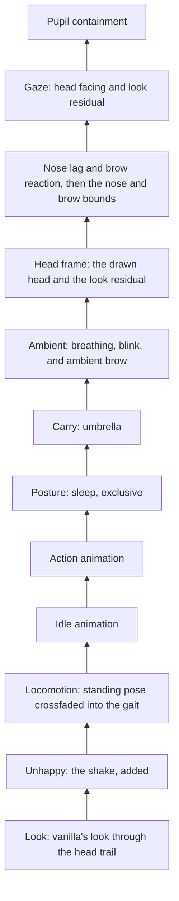
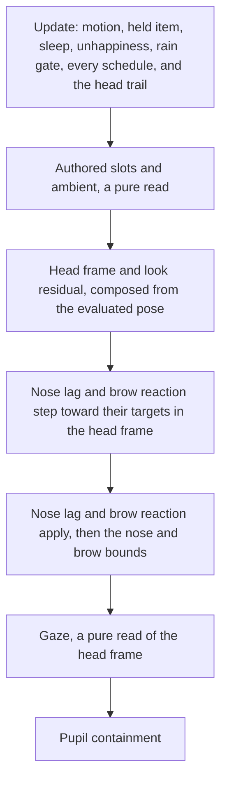
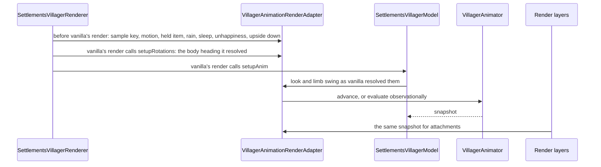

# Animation System

This document is the entrypoint for contributors changing villager animation, locomotion, arm presentation, rendered
attachments, or the ballista's motion. It explains ownership boundaries and invariants that are easy to violate across
files. It intentionally does not duplicate current enum members, animation inventories, keyframes, model hierarchy, or
dependency-injection bindings; use the linked source files and the searches
in [Finding current implementations](#finding-current-implementations) for those details.

For authoring a clip and bringing one over from Blockbench, see [Animation Import](animation_import_blockbench.md).

For settling a placement or magnitude in a running game, see
[Animation and Model Tuning](animation_model_tuning.md).

---

## Start here

| If you are changing... | Start with |
|---|---|
| Slot order, ownership, or suppression | [VillagerAnimationPipeline](../../src/main/java/dev/breezes/settlements/domain/animation/VillagerAnimationPipeline.java), [AnimationCompositor](../../src/main/java/dev/breezes/settlements/domain/animation/AnimationCompositor.java), [AnimationContribution](../../src/main/java/dev/breezes/settlements/domain/animation/AnimationContribution.java) |
| Channels, rigs, or masks | [AnimationTarget](../../src/main/java/dev/breezes/settlements/domain/animation/AnimationTarget.java), [AnimationRig](../../src/main/java/dev/breezes/settlements/domain/animation/AnimationRig.java), [VillagerAnimationRig](../../src/main/java/dev/breezes/settlements/domain/animation/VillagerAnimationRig.java), [AnimationTargets](../../src/main/java/dev/breezes/settlements/domain/animation/AnimationTargets.java) |
| Clip authoring or baking | [KeyframeAnimation](../../src/main/java/dev/breezes/settlements/domain/animation/KeyframeAnimation.java), [TrackAnimationBuilder](../../src/main/java/dev/breezes/settlements/domain/animation/TrackAnimationBuilder.java), [BakedAnimation](../../src/main/java/dev/breezes/settlements/domain/animation/BakedAnimation.java), [BakedAnimationRegistry](../../src/main/java/dev/breezes/settlements/domain/animation/BakedAnimationRegistry.java) |
| When animation advances, or what a render reads | [VillagerAnimator](../../src/main/java/dev/breezes/settlements/domain/animation/VillagerAnimator.java), [VillagerAnimationObservation](../../src/main/java/dev/breezes/settlements/domain/animation/VillagerAnimationObservation.java), [VillagerAnimationSnapshot](../../src/main/java/dev/breezes/settlements/domain/animation/VillagerAnimationSnapshot.java), [VillagerAnimationRenderAdapter](../../src/main/java/dev/breezes/settlements/infrastructure/minecraft/entities/villager/model/rendering/VillagerAnimationRenderAdapter.java) |
| The head trail, the drawn head, the nose lag, or the brow reaction | [HeadTrail](../../src/main/java/dev/breezes/settlements/domain/animation/HeadTrail.java), [HeadFrame](../../src/main/java/dev/breezes/settlements/domain/animation/HeadFrame.java), [NoseLag](../../src/main/java/dev/breezes/settlements/domain/animation/NoseLag.java), [BrowReaction](../../src/main/java/dev/breezes/settlements/domain/animation/BrowReaction.java), [ExponentialFollower](../../src/main/java/dev/breezes/settlements/domain/animation/ExponentialFollower.java), [FollowerStep](../../src/main/java/dev/breezes/settlements/domain/animation/FollowerStep.java) |
| The eye geometry, the gaze, or the pupil containment | [VillagerEye](../../src/main/java/dev/breezes/settlements/domain/animation/VillagerEye.java), [Gaze](../../src/main/java/dev/breezes/settlements/domain/animation/Gaze.java), [PupilContainment](../../src/main/java/dev/breezes/settlements/domain/animation/PupilContainment.java), [SettlementsVillagerModel](../../src/main/java/dev/breezes/settlements/infrastructure/minecraft/entities/villager/model/SettlementsVillagerModel.java) |
| Action lifetime, fades, or replay | [VillagerAnimationPipeline](../../src/main/java/dev/breezes/settlements/domain/animation/VillagerAnimationPipeline.java), [AnimationLayer](../../src/main/java/dev/breezes/settlements/domain/animation/AnimationLayer.java), [AnimationArchetype](../../src/main/java/dev/breezes/settlements/domain/animation/AnimationArchetype.java), [BaseVillager](../../src/main/java/dev/breezes/settlements/infrastructure/minecraft/entities/villager/BaseVillager.java) |
| The standing pose and gaits | [LocomotionAnimations](../../src/main/java/dev/breezes/settlements/domain/animation/LocomotionAnimations.java), [VillagerAnimationPipeline](../../src/main/java/dev/breezes/settlements/domain/animation/VillagerAnimationPipeline.java) |
| Breathing, blinking, the ambient brow, or idle animations | [AmbientAnimations](../../src/main/java/dev/breezes/settlements/domain/animation/AmbientAnimations.java), [IdleAnimations](../../src/main/java/dev/breezes/settlements/domain/animation/IdleAnimations.java), [AmbientBlink](../../src/main/java/dev/breezes/settlements/domain/animation/AmbientBlink.java), [AmbientBrow](../../src/main/java/dev/breezes/settlements/domain/animation/AmbientBrow.java), [RandomDelaySchedule](../../src/main/java/dev/breezes/settlements/domain/animation/RandomDelaySchedule.java), [IdleAnimationScheduler](../../src/main/java/dev/breezes/settlements/domain/animation/IdleAnimationScheduler.java) |
| Arm geometry | [ArmConfiguration](../../src/main/java/dev/breezes/settlements/domain/presentation/ArmConfiguration.java), [VillagerAnimationPipeline](../../src/main/java/dev/breezes/settlements/domain/animation/VillagerAnimationPipeline.java), [SettlementsVillagerModel](../../src/main/java/dev/breezes/settlements/infrastructure/minecraft/entities/villager/model/SettlementsVillagerModel.java) |
| Items, props, or sockets | [AttachmentProvider](../../src/main/java/dev/breezes/settlements/domain/attachment/AttachmentProvider.java), [Socket](../../src/main/java/dev/breezes/settlements/domain/presentation/Socket.java), [AttachmentRenderLayer](../../src/main/java/dev/breezes/settlements/infrastructure/minecraft/entities/villager/model/rendering/AttachmentRenderLayer.java) |
| Umbrella carry, deploy, or the rain gate | [UmbrellaAnimator](../../src/main/java/dev/breezes/settlements/domain/animation/UmbrellaAnimator.java), [UmbrellaCarryAnimations](../../src/main/java/dev/breezes/settlements/domain/animation/UmbrellaCarryAnimations.java), [UmbrellaAttachmentProvider](../../src/main/java/dev/breezes/settlements/infrastructure/rendering/attachment/UmbrellaAttachmentProvider.java) |
| The ballista's motion | [BallistaAnimator](../../src/main/java/dev/breezes/settlements/domain/ballista/BallistaAnimator.java), [BallistaAnimations](../../src/main/java/dev/breezes/settlements/domain/animation/BallistaAnimations.java), [BallistaModel](../../src/main/java/dev/breezes/settlements/infrastructure/minecraft/blocks/ballista/BallistaModel.java) |
| Client registration | [ClientAnimationModule](../../src/main/java/dev/breezes/settlements/di/modules/client/ClientAnimationModule.java), [ClientAttachmentModule](../../src/main/java/dev/breezes/settlements/di/modules/client/ClientAttachmentModule.java) |

---

## Mental model

Animation-related presentation is split into four independent planes:

| Plane | Question it answers | Authority |
|---|---|---|
| Motion | Which discrete action is the villager expressing? | Server intent, synchronized to clients |
| Locomotion | Which gait should play, at what phase and strength? | Server gait intent; client distance and render state |
| Loadout | Which items, props, and cosmetics exist in each attachment slot? | Server |
| Presentation | Which socket and local transform should render a slot/category pair? | Client registries |

Do not encode one plane inside another. An animation does not select an item, a socket does not select a behavior, and a
gait is selected by navigation intent rather than inferred from item or animation data.

Everything animation produces for one render is one snapshot, evaluated once for that render's sample and read by
everything that draws the villager: the model, the attachment layer, and every attachment provider. Nothing downstream
asks the animation anything else, so the head the pipeline resolves is the head that is drawn.

---

## Composition

### Rigs, channels, and poses

A channel is one rotation, translation, or scale of one bone, declared as an
[AnimationTarget](../../src/main/java/dev/breezes/settlements/domain/animation/AnimationTarget.java) that names its
bone and its kind. A rig is an immutable, ordered set of channels for one model, and gives each channel a dense index.
Three models animate through this system, each on its own rig: the villager
([VillagerAnimationRig](../../src/main/java/dev/breezes/settlements/domain/animation/VillagerAnimationRig.java)), the
umbrella prop
([UmbrellaAnimationTargets](../../src/main/java/dev/breezes/settlements/domain/animation/UmbrellaAnimationTargets.java)),
and the ballista
([BallistaAnimationTargets](../../src/main/java/dev/breezes/settlements/domain/animation/BallistaAnimationTargets.java)).

A pose ([AnimationPose](../../src/main/java/dev/breezes/settlements/domain/animation/AnimationPose.java)) is one value per
channel, held densely in rig order, and every value is relative to rest: rotation and translation are deltas that add
onto the bone's rest transform, and scale is a factor that multiplies its rest scale. Rest is zero for rotation and
translation and one for scale, so a pose reset to rest draws the model exactly as it was baked.

Each model draws a pose through
[ModelPartRigBinding](../../src/main/java/dev/breezes/settlements/infrastructure/rendering/animation/ModelPartRigBinding.java),
which binds every model-part channel to its part by the bone's name once, then on each render resets every part to rest
and applies the pose, so no render's pose depends on an earlier one. Beyond its pose a model applies only state that is
not animated, such as the villager's arm geometry and the ballista's aim.

The villager rig also holds a translation and a rotation channel for every attachment slot, so a clip can move a
carried item. Slot visibility, display context, and scale are not channels: an attachment is drawn when a provider
emits it, its display context comes from its display profile or anchor, and its scale from its socket and profile.

Masks ([AnimationMask](../../src/main/java/dev/breezes/settlements/domain/animation/AnimationMask.java)) are explicit
channel sets on one rig. A mask from one rig resolves onto any other rig holding its channels, matched by channel
identity rather than index, so a rig that appends channels to another can reuse the masks and clips authored for it.
Masks name channels, not world-space regions: rotating the torso still carries both arms and the head.

### Baking

A [KeyframeAnimation](../../src/main/java/dev/breezes/settlements/domain/animation/KeyframeAnimation.java) is the
authored clip: tracks of keyframes plus its timing and composition declarations. It is never sampled directly. A
[BakedAnimation](../../src/main/java/dev/breezes/settlements/domain/animation/BakedAnimation.java) converts it once for
one rig into primitive arrays, and sampling a baked clip writes its keyed channels straight into a pose or a
contribution without allocating. Baking is also where a clip is checked against its rig: a track on a channel the rig
lacks, two tracks on one channel, or an owned mask the rig cannot resolve throws.

Where each clip is baked follows from who plays it:

- Every clip the villager's libraries hand out is baked for the villager rig once per client session, by
  [BakedAnimationRegistry](../../src/main/java/dev/breezes/settlements/domain/animation/BakedAnimationRegistry.java),
  which finds a baked clip by the instance it was made from. A clip that no library returns is never baked, and asking
  the registry for it throws, so registering a clip in
  [ClientAnimationModule](../../src/main/java/dev/breezes/settlements/di/modules/client/ClientAnimationModule.java) is
  the only way into villager playback.
- The umbrella's carry and canopy clips and the ballista's clips are fixed content, baked statically by the classes that
  play them, the carry clips for the villager rig and the canopy and ballista clips for their own rigs.

### The slot order

The villager pipeline is a fixed slot order, folded bottom to top, followed by procedural stages that read what the
slots resolved. Adding a slot or a stage is a design change, not a registration.



Each slot contributes a sampled pose with a weight and three declarations, none of them inferred from which channels a
clip keys. The faster gaits key the pupils outward, for example, and must not lose anything for it. The procedural
stages contribute no pose of their own: each writes its few channels straight into the resolved pose and keeps only
scalar state.

### Ownership and coverage

A clip owns channels through `owns(mask)`, at full coverage, or `owns(mask, coverage)`. On an owned channel the
contribution replaces the pose below by its coverage, moving toward its own value, or toward rest where it does not key
the channel, so an override clears what sat below instead of inheriting it. A keyed channel the clip does not own adds
onto the pose below, and a keyed scale multiplies it. A channel neither owned nor keyed passes through. The slot's
weight scales all of it, so owned channels move by the weight times the coverage.

[VillagerAnimationRig](../../src/main/java/dev/breezes/settlements/domain/animation/VillagerAnimationRig.java) names a
region mask for each part of the body and face, and two rotation-only masks, `HEAD_ROTATION` and `LEG_ROTATION`. The
rotation-only masks are what clips reach for: owning the head or leg rotation leaves those bones' translations
additive, so a clip that keys only leg rotation over a moving gait keeps the gait's leg translation underneath. A region
mask would clear or replace both. Broadening a clip to a region mask is a deliberate visible change.

### Suppression

A clip turns down an ambient or procedural component through `suppresses(...)`, at full strength. The components are
[SuppressibleComponent](../../src/main/java/dev/breezes/settlements/domain/animation/SuppressibleComponent.java). A
component's remaining weight is its own weight times one minus its suppression, and suppression from several slots
combines as a product of complements, so two half suppressions leave a quarter. Ownership never suppresses a component
by itself: an action that owns the torso still breathes unless it says otherwise.

Hiding a component never pauses it. Breathing keeps its phase and the schedules keep running while suppressed, so
nothing jumps when suppression lifts.

### Exclusive playback

`playExclusively()` is shorthand for owning every model-part channel of the rig and suppressing every component. Sleep
uses it, because its clip carries its own breathing, closed lids, and head. Attachment slot channels stay outside it,
so an exclusive clip never pins a carried item. An explicit `owns(...)` on an exclusive clip overrides the full
coverage for its channels.

Exclusive is a composition profile, not a playback mode: the Posture slot still composes as a slot, and Carry still
applies above it.

### Crossfades

A slot crossfading between two clips folds each against the same pose below and blends the results by their shares.
Folding them one after the other would let part of the lower pose through mid-crossfade even when both clips own a
channel; folding both against the same lower pose keeps ownership and suppression whole through the whole crossfade,
whichever clip is listed first. The Locomotion slot crossfades the standing pose into the gait this way, so the gaits'
declared breath suppression scales with the locomotion weight, and the Action slot crossfades an outgoing clip into the
one replacing it.

### What follows from the order

- Look owns head rotation, so any slot that owns `HEAD_ROTATION` replaces the look. A gait keys the head without owning
  it, so its head bob adds onto the look and a walking villager can still turn its head. The head trail is not a
  suppressible component: it shapes the Look source, keeps following under a head owner, and so returns the head to the
  look without a snap when the owner fades out.
- The head frame is composed after ambient, so breathing's torso motion, a torso lean, and an authored head turn are
  all part of the head the nose lag trails, the brow reacts to, and gaze reads.
- The ambient brow and the brow reaction add onto whatever brow the slots resolved, and the brow bounds are the last
  write to it, so an authored brow, the ambient brow, and the reaction are bounded together, under sleep too. The
  brow the slots resolved is read before the ambient brow adds to it, which is what the procedural raise limit is
  measured against. A clip whose brow is its own expression suppresses `BROW`, as ponder does; otherwise both
  procedural brows stack onto its brow.
- Gaze adds onto whatever pupils the slots and ambient resolved, and reads the same head frame as the brow reaction.
  A clip whose pupils are its own expression suppresses `GAZE`, as ponder does; otherwise the gaze moves its pupils
  toward the look, and a clip that owns the head without suppressing `GAZE` leaves the eyes carrying the look.
- The pupil containment is the last write to the pupils' translation and scale, so every pupil source, authored,
  ambient, or procedural, is contained together, under sleep too. Gaze comes just before it, so no gaze source is
  clamped on its own.
- Locomotion owns `LEG_ROTATION` and suppresses breathing by the locomotion weight, so a half gait half-suppresses it.
- Ambient applies above every authored slot, so breathing shows over an action's torso and a blink closes the eyes over
  any authored lid pose. The blink owns the eyelids for that reason; an action that holds the eyes wide suppresses the
  blink instead.
- Sleep owns the whole body and suppresses every component. Carry sits above it, so a villager going to bed in the rain
  lowers its umbrella with its arm.

### Euler addition

Rotation composition is Euler addition: a rotation delta adds componentwise onto the angles below it, and a crossfade
interpolates the angles. It is a declared convention that suits the small additive layers these rigs use, not a general
rotation model: two rotations about different axes do not compose exactly. The head frame is the one read that composes
full rotations, because it must agree with the head the model draws; nothing it computes feeds back into clip
composition.

### Arm configuration

[ArmConfiguration](../../src/main/java/dev/breezes/settlements/domain/presentation/ArmConfiguration.java) is a discrete
per-arm choice between crossed and straight geometry. It cannot be blended, because it changes which model pieces and
sockets exist.

A clip claims a pose for one arm, for both, or for neither; an arm it does not name is left to the slots below. The
pipeline takes each arm independently from the highest slot whose current clip claims it, in the order Posture, Action,
Idle animation, then Locomotion, and defaults to crossed. Carry takes no part: the umbrella carry is authored for crossed
arms only, and letting it claim them would overrule every action beneath it. An action's claim holds from its first
tick until its layer expires, whatever its weight, so the geometry snaps at the transitions instead of fading.

The resolved value controls all of the following:

- crossed versus straight arm geometry;
- which hand socket an attachment uses;
- which authored arm targets are visible.

Mapping convention: off-hand uses the left arm and main-hand uses the right arm. Keep model visibility and socket
selection aligned with that convention.

---

## Lifecycle

### The animation clock

Every villager animation time is the villager's own age: its client tick count and the render's partial tick, kept as
a whole tick and a fraction so the sample stays exact on a long-lived villager. The age only moves forward, freezes
under pause and a tick freeze, and starts fresh with each client entity. Level game time is not used anywhere on this
path, because the client corrects it backward whenever the server's time packet lands behind its own count.

Live sample keys step back only where a tick freeze ends. A frozen villager renders at a whole tick, and the first
render after the freeze samples the running fraction of that same tick; the animator holds its snapshot through that
until the key passes it again, at most a tick later. Action starts, sleep, the unhappy ease, every schedule, breathing,
and the followers' steps all measure from this one clock.

### One update, one snapshot

[VillagerAnimator](../../src/main/java/dev/breezes/settlements/domain/animation/VillagerAnimator.java) lives on the
villager entity. It owns the pipeline, the observation live renders write in place, and the snapshot of the last
sample it accepted. It advances once for each sample key later than the last accepted one; a pass at a key equal to or
behind it reuses the snapshot. That is what lets any number of passes in one frame share one sample without a special
path, whichever of them reaches the sample first.

A live advance runs in this order:



Everything that changes state belongs to the update, with one exception, the followers of the drawn head: the nose lag
and the brow reaction follow the head as drawn, which exists only once the slots and ambient are evaluated, so their
steps are the only commits after the update. The head trail follows the observed look, which the update already has,
so it steps there. A stage that reads the head frame without keeping a follower, as gaze does, belongs after the steps
and before the bounds of the channels it writes, as a pure read.

An **observational evaluation** runs the pure parts only and changes no state. It reads committed schedules, such as
the blink and the ambient brow, as a live advance does, but evaluates every follower as settled on its own observation,
as just after a reset: the head on the observed look, the nose neutral, and the brow reaction on its target. Gaze reads
its residual from that settled head, so a preview's eyes never lead a turn. A preview
overwrites the live villager's body and head rotation, so reading the live followers would show it a turn that is not
happening, and stepping them would commit the preview's angles to the villager. The live and observational paths are
one evaluation over different followers, so they cannot drift apart.



Only the adapter knows `LivingEntityRenderer`'s call order. The body heading is the one vanilla passes to
`setupRotations`, after its adjustment for a riding villager, and the look and limb swing are the values it passes to
`setupAnim`, after its riding clamp and its upside-down flip, so nothing re-derives them. The domain sees plain values,
so a port to entity render states changes the adapter, the model's `SnapshotSource` seam, and the renderer's `render`
and `setupRotations` overrides, and nothing in the domain.

### Continuous followers

The head trail, the nose lag, and the brow reaction are the pipeline's continuous followers: each is a value that
closes a share of its distance to a target per unit of time ([ExponentialFollower](../../src/main/java/dev/breezes/settlements/domain/animation/ExponentialFollower.java)),
stepped over the interval between accepted samples
([FollowerStep](../../src/main/java/dev/breezes/settlements/domain/animation/FollowerStep.java)). The interval is
measured on the sample key, whole ticks and partial tick apart, for the same reason the clock keeps them apart.

- **Frame rate.** Each step uses the exact decay factor for its interval, so for a constant target, how an uncapped
  interval is split into frames does not change where a follower lands, and a moving target agrees across frame rates
  within a tolerance. A blend factor fixed per frame would make every follower several times shorter at a high frame
  rate than at a low one.
- **Capped steps.** A long interval steps only as far as the longest step, so a frame hitch shows the rest of a turn
  instead of skipping it. That is a deliberate departure from the exact factor.
- **Resets.** A follower lands on its target at the first observation, after a gap long enough to mean the villager was
  out of view, on waking, and from a value that is not finite. Sleep draws the villager in a bed pose the followers
  never tracked, so waking starts them over.
- **Jumps.** A heading more than a teleport-sized turn from its follower is a jump in the target, not a turn, so the
  follower lands on it. The nose lag also lands on a head heading that is undefined, where the head faces nearly
  straight up or down.

Heading followers work in world heading and wrap the shorter way, so a heading crossing the half-turn boundary gives no
full-turn impulse. Vanilla negates an upside-down villager's look before `setupAnim` and mirrors its model in world
heading, so the head trail and the nose lag undo that flip on the way in and reapply it on the way out. Nothing else in
the pipeline reasons in world heading. The brow reaction and gaze work in model space, where vanilla's flipped look
already matches the flipped model, so they take no flip at all; adding one would mistake the mirror for a residual and
turn the eyes away from the look.

The Look slot uses the **head trail** so a body turn under a fixed look does not create a new look target.
[HeadTrail](../../src/main/java/dev/breezes/settlements/domain/animation/HeadTrail.java) owns the follower's response and
body-relative yaw limit.

The **nose lag** follows the drawn head's world heading and rolls the nose by how far it trails, on top of the authored
nose roll, at `NOSE_LAG`'s remaining weight. It follows the head frame rather than the look because an authored head
turn, a torso twist, or a root turn moves the head the look knows nothing about, and a head owner holding the head
still must not roll the nose while the look swings underneath. The roll bound applies to the final nose roll, authored
roll included and under sleep too, so an authored roll past it would be clamped rather than drawn;
[NoseLagTest](../../src/test/java/dev/breezes/settlements/domain/animation/NoseLagTest.java) sweeps every production
clip's nose roll against it.

The **brow reaction** follows the look residual, described under [The drawn head](#the-drawn-head), and adds onto the
brow at `BROW`'s remaining weight. A sideways residual rolls up the brow's end on the side the look lies toward and
raises the brow; a residual above the head lifts it, and one below drops it. It moves away from neutral on a shorter
time constant than it moves back toward it, so the brow keeps pace with a turn and lingers after the head arrives; each
phase keeps the exact-decay property. The residual is
transient while the trail closes on the look, so the reaction needs no window to keep it from reading as a held tilt.
What does hold a residual is a drawn head held off the look: an action owning the head keeps the brow reacting for the
whole hold, and a gait's or breathing's torso and head motion makes it bob with the stride or the breath. Suppressing
`BROW` hides the reaction without pausing it.

The **procedural raise limit** keeps the ambient brow and the reaction together from raising the brow above a limit
lower than the final raise bound, or above the authored brow where an authored raise is already higher. An authored
raise therefore keeps its full height and the procedural brow raises it no further, while lowering and roll are not
limited this way.

The **brow bounds** limit the brow's final vertical offset to a range that keeps it off the eyes and its roll to a
little past the widest authored roll, applied after the reaction whatever its weight, so they bound every brow source,
under sleep too. [BrowReactionTest](../../src/test/java/dev/breezes/settlements/domain/animation/BrowReactionTest.java)
sweeps every production clip's brow offset and roll against them, and every ambient brow clip's raise against the
procedural raise limit.

### The drawn head

[HeadFrame](../../src/main/java/dev/breezes/settlements/domain/animation/HeadFrame.java) is the head's orientation in
model space, composed from the evaluated root, torso, and head rotations in the order the model applies them. The head
is a child of the torso, and the root rotates everything above it, so a torso lean or a root turn moves the head too:
under a clip that pitches the torso forward and the head back, the head channel alone would read a false pitch. The
villager part between root and torso carries no channel. The frame assumes no part on that chain has
a rest rotation, and
[SettlementsVillagerModel](../../src/main/java/dev/breezes/settlements/infrastructure/minecraft/entities/villager/model/SettlementsVillagerModel.java)
fails at construction if one gains one. The model keeps its own composition of the same chain for head-worn items,
because that one also needs the parts' rest offsets.

The frame's heading is measured as a head yaw channel value, so a pose whose only rotation is a head yaw has that yaw
as its heading, and the world heading is the body heading plus it. No camera transform is involved.

The frame also carries the **look residual**: the observed look's direction expressed in the drawn head's own axes,
read as its rightward and downward components. The look is where vanilla's head yaw and pitch alone would turn the head,
so the residual is zero while the head is drawn on the look: a settled trail, no head owner, and no torso or root
motion. It is nonzero while the trail closes on a turn, while an action holds the head off the look, and while the
torso or root carries the head away. Components rather than angles keep it defined where the head or the look faces
nearly straight up or down. The brow reaction follows it, and gaze reads it.

The frame's **facing** is the drawn head's forward direction in model space, read the same way as rightward and
downward components, so it stays defined where the heading does not. Gaze reads it.

### The eye rig

[VillagerEye](../../src/main/java/dev/breezes/settlements/domain/animation/VillagerEye.java) is the one authority for
the eye's geometry: the white's extents, the pupil's rest size, and each pupil's rest position.
[SettlementsVillagerModel](../../src/main/java/dev/breezes/settlements/infrastructure/minecraft/entities/villager/model/SettlementsVillagerModel.java)
builds the eyeball and pupil boxes and the pupils' rest offsets from it, and the pupil containment bounds the pupils by
it, so the drawn eye and its bounds cannot drift apart.

- **The rest size is in the box, not the part's scale.** The pupil's box is shrunk from its texture square through the
  cube's deformation, which keeps its UVs. A pose reset returns every part's scale to one, so a rest size carried as
  the part's scale would need a per-part rest factor in the generic binding. A pupil scale a clip keys multiplies the
  rest size.
- **The outward offset is rest geometry.** Each pupil rests just outward of its eye's inner edge, the edge nearer the
  middle of the face, and the two eyes mirror each other. A clip keys only its departure from that rest. A shared
  offset carried by clips instead must be re-keyed by every alternative of a crossfade, and an additive clip over one
  that carries it doubles it.

The **pupil containment**
([PupilContainment](../../src/main/java/dev/breezes/settlements/domain/animation/PupilContainment.java)) keeps each
pupil within its eye, measured on the pupil's rest size times its resolved scale, so a pupil an expression narrows or
squashes meets each bound with its own edge. The white's outer edge is a plain stop. Its inner edge, the one nearer the
middle of the face, and its bottom edge are hard bounds that squash: a push past either squashes the pupil against
that edge while its far edge follows the push, down to one minimum share of its width or height, rather than moving
it through. A pupil carried inward thus narrows against the middle of the face, and one carried down shows more white
above. Upward the pupil may slide under the eyelid, which sits in front of it, by up to half its height. The bounds
are in eyeball-local units, because the pupil is a child of its eyeball, so an eyeball's own scale and translation
move the white and the pupil together.
[PupilContainmentTest](../../src/test/java/dev/breezes/settlements/domain/animation/PupilContainmentTest.java) sweeps
every production clip's pupils, composed with rest, against the bounds, and an authored pupil outside them is retuned
rather than preserved.

### Gaze

[Gaze](../../src/main/java/dev/breezes/settlements/domain/animation/Gaze.java) adds one offset onto both pupils, in the
same model-space direction for each, at `GAZE`'s remaining weight. It sums two sources:

- **Head facing:** a share of the drawn head's facing from [The drawn head](#the-drawn-head), so the eyes look further
  the way the head faces from the body, whichever bone on the chain turns it.
- **Look residual:** the residual of the same frame. While the head trail closes on a turn the eyes arrive first and
  recenter as the head catches up; while an authored hold or a torso or root turn keeps the drawn head off the look,
  the eyes carry the look.

Both read the head as drawn, not vanilla's look, so under a hold that keeps the head straight the head facing adds
nothing and the eyes land on the look through the residual alone.

The pupils rest against their eyes' inner edges, so the shared offset moves one pupil outward while the containment
squashes the other against its inner edge. The containment applies to the sum, never to one source.

Gaze keeps no state. Nothing smooths the offset: vanilla's look is already interpolated, and the trail and the head
frame move continuously, so a filter would only make the eyes drift where real eyes jump. It reads only the head
frame; nothing searches the world or casts rays, and nothing moves the eyes on its own.

Sleep's exclusive profile and ponder suppress `GAZE`. A clip that owns the head without suppressing it leaves the eyes
on the look, which suits work aimed at the villager's look target; whether a clip's pupils are its own expression is
decided clip by clip, as [Animation Import](animation_import_blockbench.md) describes.

### Passes

| Pass | Treatment |
|---|---|
| World render | Advance if the sample key is new; otherwise reuse the snapshot |
| Repeat render at the same key, such as a shader mod's shadow pass | Reuse the snapshot |
| Outline pass, marked by `SupplementaryEntityPass` (**P8**) | The same rule as a world render; the mark only suppresses decoration, such as speech bubbles |
| Stats preview | Observational: evaluated into the renderer's own snapshot with the followers settled on the preview's observation, advancing and committing nothing; its attachments read that snapshot |
| Render that is not a live sample, such as another mod's inventory preview of a live villager | Observational, as the stats preview |
| Render with no client session, such as another mod's out-of-world preview | The look through a head trail settled on it and the unhappy shake alone, through [StatelessVillagerAnimator](../../src/main/java/dev/breezes/settlements/domain/animation/StatelessVillagerAnimator.java); arms crossed and the umbrella hidden |

The outline pass runs after the frame's own entity pass, so within a frame it never comes first. It can come alone: it
picks villagers by frustum, while vanilla's pass also skips an entity whose chunk section has not compiled yet. Under
pause or a tick freeze, a later frame's own pass samples the same key after it. It renders with the partial tick
vanilla's pass uses for the same entity, so both share one sample.

A preview defeats the sample key: it overwrites the live villager's body and head rotation and renders with a partial
tick of one, which reads as a newer sample. Every villager render made while
[ObservationalVillagerRenderFlag](../../src/main/java/dev/breezes/settlements/infrastructure/rendering/animation/ObservationalVillagerRenderFlag.java)
is raised evaluates without committing. The renderer raises it around any render that is not a live sample, by
[VillagerAnimator.isLiveSample](../../src/main/java/dev/breezes/settlements/domain/animation/VillagerAnimator.java),
which catches another mod's preview. Under a tick freeze a live render also samples at a whole tick, so the stats
preview, whose key would then equal the live one, raises the flag around vanilla's inventory render itself. The flag
needs no copy of vanilla's inventory-render code and carries over to later render APIs, which marking the buffer source
would not.

### Motion replay and action lifetime

Motion synchronization uses two values:

- the archetype identifies the action;
- the generation changes when the same one-shot must replay.

A new generation plays its archetype's clip once; a changed archetype under the same generation holds its clip until
the motion changes; `NONE` fades the action out. Use the continuous setter for level states that should not restart
when written repeatedly, and the trigger setter for discrete actions that must restart even when the archetype is
unchanged. One-shots expire after their duration and blend-out; behavior code should not repeatedly restore idle during
the clip.

The pipeline keeps what the motion asks for apart from the layer playing it, so the request outlives a layer that
expires early or changes clip:

- **Held-item lag.** Motion data can arrive before equipment data, so the first resolution may use the wrong item
  category. When the held item changes, the action plays the newly resolved clip as if it had been resolved at the
  action's start, keeping its lifetime, so a one-shot neither restarts nor becomes held. A one-shot whose layer expired
  on the empty clip before its item arrived plays the right clip the same way, while that clip still covers the time
  since the start; a one-shot that played its own clip to the end stays over.
- **First observation.** A villager is often first seen with an action already under way. The first observation adopts
  the synced motion as already seen, so nothing counts as a trigger. A looping clip holds from that observation at full
  weight, its blend-in already past; a clip that plays once is skipped, being over or already partly missed, unless a
  later held item resolves the action to a looping clip, which then holds the same way.

---

## Locomotion, idle animations, ambient, umbrella, and sleep

### Locomotion

Gait selection is based
on [NavigationType](../../src/main/java/dev/breezes/settlements/domain/ai/navigation/NavigationType.java), not raw
speed. Genetics and effects can change speed without changing intent.

The Locomotion slot crossfades the standing pose into the gait by the locomotion weight, which comes from the limb-swing
amount. The gait is phased by limb swing, one vanilla limb cycle to one clip cycle. Limb swing is distance-based, so
footfalls stay planted across speed changes. The model has no procedural leg swing of its own.

### Idle animations

An idle animation is eligible only while the villager is awake, at a standstill, and holding no action. Movement, an
action, or sleep fades the current one out and cancels it entirely, and the next waits a fresh interval once
eligibility returns. The same idle animation never plays twice in a row while another is available.

### Ambient

Breathing is an additive cycle with a per-villager phase. The blink owns the eyelids and closes them along the blink
clip's curve. The ambient brow plays the ambient library's brow motions, raises and tilts, one at a time on slow
per-villager windows, each at a random strength between a floor and its authored extent, and adds them onto the brow at
`BROW`'s remaining weight. Since a motion only adds, its strength scales its weight, so a clip authors the largest
motion it may play, and an authored raise stays within the procedural raise limit, which it shares with the brow
reaction. Each motion keys only brow channels and
declares no ownership or suppression, which the ambient brow checks when it is built, so it can only ever add to the
brow.

### Randomness and schedules

Cosmetic timing and animation choices use shared randomness: the exact sequence for a villager need not repeat when
its animator is recreated, so no villager carries a seed of its own. The pipeline takes its source as a constructor
argument; [RandomUtil](../../src/main/java/dev/breezes/settlements/shared/util/RandomUtil.java) documents when the
shared source is appropriate, and tests pass a seeded generator.

Blink, ambient brow, and idle schedules run on whole ticks of the animation clock. A late observation samples an
animation from its scheduled start, and the next wait counts from the previous animation's end. A start missed beyond
the schedule's tolerance is discarded and a fresh wait begins, so stale animations are not replayed when a villager
returns to view. Scheduled starts and natural ends stay anchored when updates arrive late within that tolerance. The
blink and the ambient brow share these rules through
[RandomDelaySchedule](../../src/main/java/dev/breezes/settlements/domain/animation/RandomDelaySchedule.java), which
any further randomly timed ambient or procedural motion should reuse rather than restate. The idle scheduler
implements them itself because it also gates on eligibility and cancels a running animation; its eligibility changes
take effect when observed.

### Umbrella

The umbrella is a rain-gated attachment rather than an archetype: no behavior selects it and no archetype resolves to
it. [UmbrellaAnimator](../../src/main/java/dev/breezes/settlements/domain/animation/UmbrellaAnimator.java) owns its
deploy/stow state machine. It supplies the Carry slot's arm motion, the prop's own pose on the umbrella rig, and whether
the umbrella shows, all into the snapshot.

Its gate is steadied twice, on opposite sides of the network boundary, and neither pass substitutes for the other:

- the server debounces its rain sample before publishing, so a villager crossing under an eave never puts a flicker on
  the wire;
- each client animator holds its own delay before committing a change that does arrive, so a crowd whose gate flips on
  one tick does not raise in unison.

Two consequences are easy to break from the outside:

- **Visibility outlives the gate.** Whether to render the attachment at all is the snapshot's answer, not the gate's, so
  the umbrella stays on screen for the whole lower-and-close instead of disappearing the instant the rain stops.
- **Sleep shuts the gate rather than dropping the umbrella.** A sleeping villager's gate reads closed, and Carry sits
  above Posture, so a villager going to bed stows its umbrella instead of losing it mid-motion, and raises it again on
  waking in the rain.

The carry clips and the canopy clips overlap by design, in both directions. The carry pair additionally carries an
invariant that a retune can break with nothing failing until someone watches an interrupt; it is stated
at [UmbrellaCarryAnimations](../../src/main/java/dev/breezes/settlements/domain/animation/UmbrellaCarryAnimations.java).

### Sleep

Sleep is vanilla-synchronized state, not motion-plane data. The renderer reads `isSleeping()`; the `SLEEP` archetype
exists as a library lookup key only.

The Posture slot snaps in and out with the sleeping flag, as vanilla's bed rotation does, and restarts the sleep loop
on entry. Actions underneath keep their lifetimes while the villager sleeps, so a one-shot that ran out during sleep
does not replay on waking.

---

## Attachments and presentation

A [RenderableAttachment](../../src/main/java/dev/breezes/settlements/domain/attachment/RenderableAttachment.java)
describes a slot, content, and
category. [AttachmentProvider](../../src/main/java/dev/breezes/settlements/domain/attachment/AttachmentProvider.java)
implementations receive the villager and the snapshot for this render and return what to draw; client bindings are
assembled in [ClientAttachmentModule](../../src/main/java/dev/breezes/settlements/di/modules/client/ClientAttachmentModule.java).
A model content carries its prop's pose on its own rig, taken from the snapshot by the provider that emits it.

Presentation is resolved independently:

- [SlotAnchor](../../src/main/java/dev/breezes/settlements/domain/presentation/SlotAnchor.java) maps a slot and arm pose
  to a socket;
- [Socket](../../src/main/java/dev/breezes/settlements/domain/presentation/Socket.java) identifies a model bone and
  local transform;
- [AttachmentDisplayProfile](../../src/main/java/dev/breezes/settlements/domain/presentation/AttachmentDisplayProfile.java)
  supplies slot/category tuning;
- [SlotTargets](../../src/main/java/dev/breezes/settlements/domain/animation/SlotTargets.java) names a slot's
  translation and rotation channels;
- [AttachmentModel](../../src/main/java/dev/breezes/settlements/infrastructure/minecraft/entities/villager/model/rendering/AttachmentModel.java)
  is the seam for content that draws as a baked rig rather than through the item pipeline, and
  [AttachmentModelRegistry](../../src/main/java/dev/breezes/settlements/infrastructure/minecraft/entities/villager/model/rendering/AttachmentModelRegistry.java)
  resolves a content's model id to one. That registry is built by the renderer rather than supplied by Dagger, because
  baking a layer is only reachable from the renderer's own context.

The render order is:

1. choose the socket from slot and resolved arm pose;
2. replay the full root-to-bone transform chain;
3. apply the socket-local transform;
4. apply the display profile;
5. apply the slot's channels from the snapshot, turning about the content's own root pivot rather than about the origin
   it is drawn at (**P15**);
6. render the attachment content.

A socket transform must start at the model root. Attachment rendering occurs after the model render pass has closed its
pose-stack scope, so no ancestor transform can be assumed to remain active.

### The villager model

[SettlementsVillagerModel](../../src/main/java/dev/breezes/settlements/infrastructure/minecraft/entities/villager/model/SettlementsVillagerModel.java)
holds its bones and its rig binding, and applies the snapshot's pose and arm geometry on each render.

Head-worn items follow the drawn head, not the head bone alone: vanilla's head layers apply only the transform of the
part `getHead()` returns, so the model returns one that carries the whole chain from the root.

For the authoritative model hierarchy,
inspect [SettlementsVillagerModel](../../src/main/java/dev/breezes/settlements/infrastructure/minecraft/entities/villager/model/SettlementsVillagerModel.java)
or the Blockbench source at [settlements_villager.bbmodel](../../assets/models/settlements_villager.bbmodel). Do not
copy the hierarchy into this document.

---

## Authoring animations

Clips are authored as tracks with
[TrackAnimationBuilder](../../src/main/java/dev/breezes/settlements/domain/animation/TrackAnimationBuilder.java), in
factory classes grouped by feature. [Animation Import](animation_import_blockbench.md) is the authoring guide: the
rest-relative conventions, the declarations a clip makes, and how a clip reaches playback.
[ClientAnimationModule](../../src/main/java/dev/breezes/settlements/di/modules/client/ClientAnimationModule.java) is the
authoritative registration map for villager clips. Do not add a documentation inventory of registered clips; search the
registration map.

### Add an action animation

1. Add or choose
   an [AnimationArchetype](../../src/main/java/dev/breezes/settlements/domain/animation/AnimationArchetype.java).
2. Author a factory clip with explicit blend and lifetime metadata and the declarations its pose needs.
3. Register the archetype/category key
   in [ClientAnimationModule](../../src/main/java/dev/breezes/settlements/di/modules/client/ClientAnimationModule.java).
4. Trigger or set the motion from the owning behavior according to replay semantics.
5. Keep gameplay timing constants with the authored clip when behavior code must coordinate an impact, sound, or release
   tick.
6. Test lifetime, missing-target behavior, and return to the slots underneath.

### Add an asymmetric gesture

1. Declare the pose of each arm the gesture needs; an arm left unnamed stays with the slots below.
2. Add timeline changes only where geometry must switch.
3. Author only the visible arm targets required by each phase.
4. Verify held attachments move to the matching socket when geometry changes.
5. Test both arms independently.

### Add an animation channel

1. Define the target, with its bone and kind,
   in [AnimationTargets](../../src/main/java/dev/breezes/settlements/domain/animation/AnimationTargets.java)
   or [SlotTargets](../../src/main/java/dev/breezes/settlements/domain/animation/SlotTargets.java), or beside the
   umbrella's or the ballista's rig.
2. Add it to its rig, and on the villager rig to every mask that should cover it. A model binds a part channel by its
   bone's name, so the bone must name a part of the baked layer; a slot channel is read by the attachment layer.
3. Add compositor tests for its kind if it is the first of a kind, including ownership, partial weights, and an unkeyed
   owned channel.
4. Add it to authored clips only after the consumer exists.

Do not duplicate the target catalog here; search target declarations and usages.

### Add a socket

1. Add the model reference only if an
   existing [ModelPartRef](../../src/main/java/dev/breezes/settlements/domain/presentation/ModelPartRef.java) cannot
   address the bone.
2. Add the complete root-to-bone chain
   in [SettlementsVillagerModel](../../src/main/java/dev/breezes/settlements/infrastructure/minecraft/entities/villager/model/SettlementsVillagerModel.java).
3. Register the [Socket](../../src/main/java/dev/breezes/settlements/domain/presentation/Socket.java).
4. Map the appropriate slot and arm pose
   through [SlotAnchor](../../src/main/java/dev/breezes/settlements/domain/presentation/SlotAnchor.java).
5. Add or update the slot/category display profile.
6. Verify transforms in motion, not only at the rest pose.

---

## The ballista

The ballista animates on its own rig with the same channels, poses, baked clips, and binding as the villager, but with
no slot pipeline: one clip plays at a time, and the stages between clips hold still poses.
[BallistaAnimator](../../src/main/java/dev/breezes/settlements/domain/ballista/BallistaAnimator.java) maps the
[state machine](../../src/main/java/dev/breezes/settlements/domain/ballista/BallistaStateMachine.java) onto them: an
unwound machine holds the rest pose, a cocked one holds the wind clip's last frame, and winding and firing play their
clips from the state's own start instant.

- **Only a state change changes what plays.** Sampling is a pure read, so a frame sampled more than once in a tick
  cannot age the animation. A clip already playing finishes even when a settled state arrives early from the server,
  and a newer winding or firing replaces it from its own start.
- **No crossfade.** Each clip starts on the pose it leaves and ends on the one it reaches, which
  [BallistaAnimationsTest](../../src/test/java/dev/breezes/settlements/domain/animation/BallistaAnimationsTest.java)
  holds to, so a cut between them is invisible.
- **Its own clock.** The client samples on the block entity's own tick counter, the counter its copy of the state
  machine records instants on, so a clip's start and the stage it settles into are measured on one clock. Sampling on
  level game time instead would misplace every clip against the stages it plays between.

[BallistaModel](../../src/main/java/dev/breezes/settlements/infrastructure/minecraft/blocks/ballista/BallistaModel.java)
turns the aim bone, which carries no channel, about its own pivot and applies the pose through the shared binding.

---

## Finding current implementations

Prefer a code search over adding inventories to this document. Useful starting searches from the repository root:

```powershell
rg "AnimationKey\.of" src/main/java/dev/breezes/settlements/di/modules/client/ClientAnimationModule.java
rg "target\(AnimationTargets\." src/main/java/dev/breezes/settlements/domain/animation
rg "\.owns\(|\.suppresses\(|\.playExclusively\(" src/main/java/dev/breezes/settlements/domain/animation
rg "AnimationRig\.of" src/main/java
rg "SlotTargets\." src/main/java
rg "AnimationArchetype\." src/main/java
rg "ModelPartRef\." src/main/java
rg "SocketId\." src/main/java
rg "AttachmentSlot\." src/main/java
rg "InMemoryAttachmentModelRegistry" src/main/java
```

Use the code for:

- current enum members;
- registered clips and category fallbacks;
- exact keyframes and authored values;
- the live model hierarchy;
- socket coordinates and display profiles;
- dependency-injection bindings;
- current animation or attachment inventories.

Those facts change frequently and are safer to discover than to synchronize manually in prose.

---

## Testing and validation

Animation core tests live under [domain/animation tests](../../src/test/java/dev/breezes/settlements/domain/animation),
and the ballista's under [domain/ballista tests](../../src/test/java/dev/breezes/settlements/domain/ballista). When
changing the system, cover the smallest relevant boundary:

- baked sampling: key values, interpolation, easing, and every loop mode;
- that every production clip bakes for the rig holding its channels, and carries the composition declarations every
  clip of its kind must carry;
- composition: ownership, additive channels, scale, crossfades, suppression, and per-arm claims;
- blend-in, replacement, clear, and expiration boundaries;
- one-shot replay, sustained action lifetime, held-item re-resolution, and the first observation;
- one advance per sample key, observational evaluation, and the stateless evaluation;
- schedules agreeing across frame partitions given identical random draws, and villagers sharing one random source
  starting apart;
- followers: exact agreement across frame partitions for a constant target, the step cap and every reset rule apart,
  agreement within a stated tolerance across frame rates for a moving target, the heading wrap, jumps, and the
  upside-down flip;
- the head trail on a fixed target under a turning body and at its clamp, the head frame under torso and root turns and
  a forward lean with the head pitched back, and the nose lag's settling, snapping, suppression, and bound;
- the look residual at zero on a settled look and carrying a head hold or a turn below the head, the brow reaction's
  direction, its rise and return across frame rates, its suppression without pausing, the procedural raise limit over
  a neutral and an authored raise, and the brow bounds;
- the pupils' mirrored rest by their eyes' inner edges, and the pupil containment per eye: the outer edge's stop, the
  inner and bottom edges' squashes and their minimum, the resolved size, the slide under the lid, and the bounds
  holding under sleep;
- gaze: each source's direction with both pupils moving alike, the head's facing from any bone on the chain and
  through straight down, the eyes leading a turn and recentering, a turn below the head under a fixed look, a head
  hold carrying the residual alone, the upside-down mirror, its weight and suppression, the containment bounding it
  awake and sleep leaving none, and the observational evaluation reading the settled head;
- locomotion at zero, partial, and full weight, gait selection, and limb-swing phase;
- sleep snapping and the umbrella stowing under it;
- the ballista's poses through winding, firing, and a clip replaced or outlived by its state.

Production clips are discovered from their factories rather than listed, so a new clip is covered without an edit to
any test.

Run the animation suite while iterating:

```powershell
.\gradlew.bat test --tests "dev.breezes.settlements.domain.animation.*"
```

Run the full suite before handoff:

```powershell
.\gradlew.bat test
```

Visual verification is still required for authored motion, socket placement, clipping, Euler rotation behavior,
head-worn items, the stats preview, the outline pass, and transitions involving geometry visibility. Check the head
trail, the nose lag, and the brow reaction on sharp turns, on riding and upside-down villagers, and on waking; the brow
under each gait and under actions that hold the head; a group of villagers for brows that move together; the pupils at
rest, under the wide-eyed gaits, through an idle animation's blend, and under work expressions; and the gaze leading
sharp turns and recentering, carrying the look under actions that hold the head, on upside-down villagers, and in the
stats preview.

---

## Deliberate constraints

These are design boundaries, not current-work inventories:

- Rotations use Euler vectors. Introduce quaternion targets and spherical interpolation before authoring rotations that
  wrap past 180 degrees or expose gimbal behavior.
- Every channel value is relative to rest, and a model writes no animated value outside its pose. A value written onto
  a part outside the pose is invisible to every stage that reads the resolved pose.
- Steady-state villager updates, evaluations, and advances allocate nothing, and neither do ballista samples. No test
  measures allocation, so review holds this. The attachment providers' per-render results are outside the guarantee.
- Ownership, suppression, and arm claims are declared per clip, never inferred from keyed channels.
- Arm geometry switches discretely; it is not crossfaded.
- Sleep switches discretely with vanilla bed state.
- The renderer iterates attachments rather than special-casing the main hand.
- The animation clock is the villager's age, never level game time, which the client corrects backward.
- The animator lives on the villager, not in a table keyed by entity id. Such a table can only be cleared by asking
  the client level which ids it still holds, and a villager drawn outside any level, such as a spawner's, is never
  there, so every clear restarts its animation. Its id also comes from the client's own entity counter, so on a
  dedicated server it can equal a loaded villager's server-assigned id.
